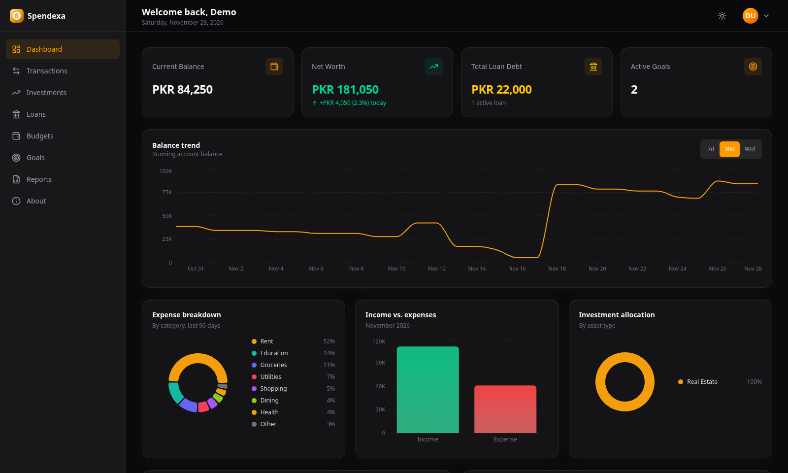

# Abdul Hanan

### Software Engineer · Co-Founder & Technical Lead at Hantalyze

---

## About me

I'm **Abdul Hanan**, a software engineer and **Co-Founder & Technical Lead at [Hantalyze](https://hantalyze.com)**, based in Pakistan. I build full-stack applications, backend APIs, relational database workflows and real-time software.

I'm pursuing a BS in Computer Science at the University of the Punjab, Gujranwala Campus. My engineering focus includes software architecture, authentication and authorization, maintainable application design, and practical AI integrations and business automation.

## Selected projects

### 01 · Spendexa-Web — Personal Finance Platform

A full-stack rebuild of a C++ console application, moving from CSV persistence to a relational data model and REST API. Covers transactions, budgets, savings goals, loans, investments and reports.

`React` · `TypeScript` · `Node.js` · `Express` · `PostgreSQL` · `Prisma`

Source repository currently private · [Live demo (sign-in required)](https://spendexa-web.vercel.app/) · [Original C++ project](https://github.com/abdul-hanandev/Spendexa)

### [02 · Tradealyze — Real-Time Trading Simulator](https://github.com/abdul-hanandev/Tradealyze)

A C++ order-matching engine connected to a browser-based trading terminal through WebSockets. Explores simulated market data, order books, matching logic and wallet state.

`C++` · `Crow` · `Asio` · `WebSockets` · `JavaScript`

[Source code](https://github.com/abdul-hanandev/Tradealyze) · [Project walkthrough](https://www.linkedin.com/feed/update/urn:li:activity:7473013960057708544/)

### 03 · EstateSync — Housing Society Management

A team-built database systems project for plot availability, bookings, maintenance billing and resident workflows, using role-based access control and relational data modelling.

`Python` · `Flask` · `MySQL` · `Bootstrap` · `Jinja`

Team coursework project. The source repository is private while the portfolio version is being prepared.

## Engineering toolkit

| Area | Technologies |
| --- | --- |
| Languages |  |
| Frontend |  |
| Backend & APIs |  |
| Databases |  |
| Developer tools |  |

**Engineering focus:** REST API design · Relational databases · Real-time systems · Authentication & authorization · Testing & debugging · AI integrations & automation

## Building at Hantalyze

I co-founded Hantalyze with Umar Azam and contribute to technical direction, software architecture, backend engineering, database design and product development. I also explore how AI integrations and workflow automation can address real business requirements.

[Meet the co-founders](https://hantalyze.com/about) · [Hantalyze website](https://hantalyze.com)

## Contributions

<picture>
  <source
    media="(prefers-color-scheme: dark)"
    srcset="https://raw.githubusercontent.com/abdul-hanandev/abdul-hanandev/output/github-contribution-grid-snake-dark.svg"
  />
  <source
    media="(prefers-color-scheme: light)"
    srcset="https://raw.githubusercontent.com/abdul-hanandev/abdul-hanandev/output/github-contribution-grid-snake.svg"
  />
  
</picture>

## Connect

For engineering discussions, professional opportunities and technology collaborations, connect with me on [LinkedIn](https://www.linkedin.com/in/abdul-hanandev/). For business inquiries, visit [Hantalyze](https://hantalyze.com/contact).

**Build thoughtfully. Engineer reliably. Keep learning.**

